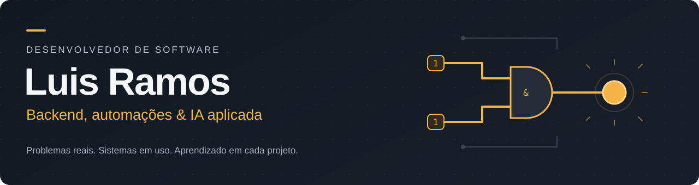

  <a href="https://luispassosramos.github.io/LuisPortifolio/"><strong>Explore meu portfólio ↗</strong></a>
  &nbsp; · &nbsp;
  <a href="https://www.linkedin.com/in/luis-guilherme-passos-ramos/"><strong>Vamos conversar no LinkedIn ↗</strong></a>

### Olá, eu sou o Luis 👋

Sou **Luis Guilherme Passos Ramos**, desenvolvedor de software e estudante de **Análise e Desenvolvimento de Sistemas no IFBA**, campus Santo Antônio de Jesus, Bahia. Meu foco é **backend com Java e Python, APIs e automações**, com interesse em **IA aplicada a problemas de negócio**.

Gosto de partir de uma necessidade concreta e construir o caminho até a solução: regras de negócio, banco de dados, integrações e uma interface que ajude quem vai usar.

### O que estou construindo

- **Software para uma operação real.** Sou cofundador da **Olympus 3D** e desenvolvo o sistema de gestão e caixa usado pela equipe: custos de impressão, pedidos, vendas, estoque e produção. Uso Next.js, React, TypeScript e Turso/libSQL, com integração opcional à API do Gemini e alternativas baseadas em regras.
- **Jogos como ferramenta de ensino.** Meu TCC é o **LogicGates**, um mod educacional de Hytale em Java. Alavancas, cabos, lâmpadas e sete portas lógicas permitem montar circuitos e observar o resultado dentro do jogo.
- **Automação no dia a dia.** No estágio de TI, atuo com suporte, manutenção, rede e automações administrativas, incluindo um fluxo que transforma questões sem formatação em provas no padrão da escola.

### Projetos para começar

| Projeto | O que você encontra | Onde conferir |
| :--- | :--- | :--- |
| **Olympus 3D** · produto em uso | Gestão de pedidos, custos, caixa e estoque; aplicação utilizada por cinco gestores em novembro de 2026. Código privado. | [Case e decisões técnicas](https://luispassosramos.github.io/LuisPortifolio/projetos/olympus-3d/) |
| **LogicGates** · TCC em desenvolvimento | Java, avaliação de circuitos, testes automatizados e integração com Hytale. A etapa Classroom está planejada. | [Código](https://github.com/LuisPassosRamos/LogicGatesMod) · [Case](https://luispassosramos.github.io/LuisPortifolio/projetos/logicgates/) |
| **IoT Management System** · acadêmico em equipe | Backend com FastAPI e SQLAlchemy, reservas, controle de acesso, auditoria e WebSocket; dispositivos simulados. Minha participação se concentra no backend. | [Código](https://github.com/LuisPassosRamos/IoT-Management-System) · [Case](https://luispassosramos.github.io/LuisPortifolio/projetos/iot-management-system/) |
| **SISD** · acadêmico em equipe | Simulação distribuída de sensores climáticos com TCP, gRPC, multicast UDP, eleição de coordenador e recuperação de falhas. | [Código](https://github.com/LuisPassosRamos/TrabalhoFinalSD) · [Case](https://luispassosramos.github.io/LuisPortifolio/projetos/sisd/) |
| **IoT Ecosystem** · acadêmico em equipe | Arquitetura Edge–Fog–Cloud com sensores simulados, MQTT, Node-RED, FastAPI e Docker. Participação concentrada no backend. | [Código e arquitetura](https://github.com/LuisPassosRamos/IoT-Ecosystem) |

O [gerador de provas](https://luispassosramos.github.io/LuisPortifolio/projetos/gerador-de-provas/) também está documentado no portfólio, com o fluxo da automação e seus limites.

### Tecnologias que uso, com contexto

| Frente | Tecnologias e experiência |
| :--- | :--- |
| **Backend** | **Python · FastAPI · SQLAlchemy** em projetos acadêmicos; **Java** no LogicGates e experiência acadêmica com **Spring Boot**. |
| **Aplicações web** | **TypeScript · Next.js · React · Turso/libSQL** no Olympus 3D; **Astro** neste portfólio. |
| **Integração e tempo real** | **APIs REST · WebSocket · MQTT · gRPC · sockets TCP/UDP**, conforme o projeto. |
| **Qualidade e entrega** | **Git · Docker · GitHub Actions · JUnit · pytest · Vitest**, com testes e documentação nos projetos principais. |
| **Automação e IA aplicada** | Integração da **API do Gemini**, organização de informações e edição de conteúdo, combinadas com fluxos baseados em regras. |

### Além do código

Impressão 3D, jogos e modding fazem parte do que gosto de criar. Também produzo conteúdo sobre Hytale no canal **SISSO**. Me interessa transformar ideias em algo que outras pessoas consigam usar, explorar e aprender.

**Estou disponível para oportunidades em desenvolvimento backend, automações e IA aplicada, além de projetos sob demanda.**

→ [Conheça os cases no portfólio](https://luispassosramos.github.io/LuisPortifolio/) · [Entre em contato pelo LinkedIn](https://www.linkedin.com/in/luis-guilherme-passos-ramos/)
